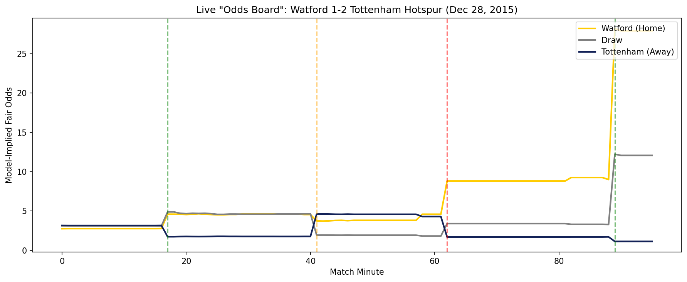
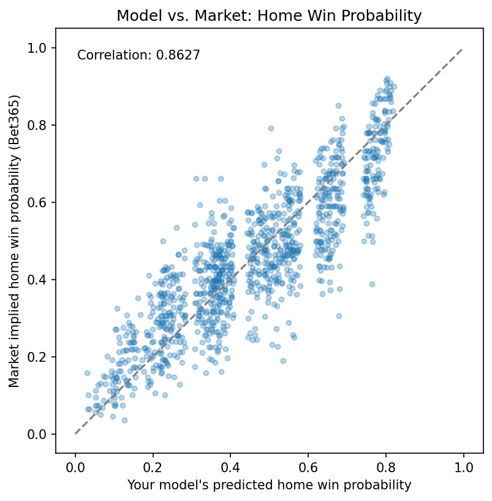
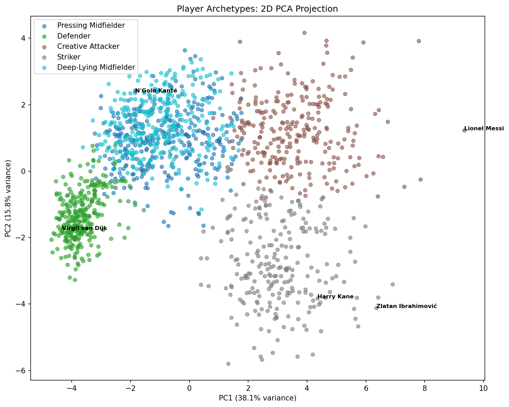

# European Soccer Analytics: Win Probability + Player Archetype Engine

A two-part analytics project: a live, in-match soccer win-probability model (built on
StatsBomb event data, validated against real bookmaker odds), and a player
archetype-clustering tool for identifying stylistically similar — but potentially
cheaper or lower-profile — players.





---

## What this project does

- **Predicts a soccer match's win/draw/loss probability before kickoff**, using an
  Elo rating system built from historical team results (`notebook 02`)
- **Updates that prediction live, minute by minute**, as a match unfolds — incorporating
  score, possession, shot quality (xG), red cards, and shot momentum (`notebook 03`)
- **Benchmarks both the pre-match and live models against real bookmaker odds**, to see
  how the model stacks up against an actual, efficient betting market (`notebook 04`)
- **Clusters ~1,400 players across four top European leagues into tactical archetypes**,
  and finds "similar players" by style — regardless of club reputation or price tag,
  aimed at surfacing undervalued alternatives to star players (`notebook 05`)

---

## Repo structure

```
soccer-analytics-project/
├── README.md
├── data/
│   ├── raw/                  # Raw pulls from StatsBomb, Understat, FBref, odds
│   └── processed/            # Cleaned feature tables, saved models, cached artifacts
├── notebooks/
│   ├── 01_data_pipeline.ipynb
│   ├── 02_prematch_prior_tool.ipynb
│   ├── 03_live_update_model.ipynb
│   ├── 04_market_comparison.ipynb
│   └── 05_player_clustering.ipynb
├── src/
│   ├── data_loader.py          # Raw data pulling (StatsBomb, Understat, FBref, odds)
│   ├── prematch_prior.py       # get_prematch_prior(), Elo rating logic
│   ├── live_win_prob_model.py  # get_live_win_prob(), get_live_fair_odds(), live features
│   └── player_clustering.py    # find_similar_players()
└── visuals/                    # Saved chart images for this README
```

---

## Data sources

| Source | Used for | Coverage |
|---|---|---|
| [StatsBomb Open Data](https://github.com/statsbomb/open-data) | Match events, live-model features, player clustering | La Liga, Premier League, Serie A, Ligue 1 — 2015/2016 |
| [Understat](https://understat.com) | Team-level xG history for the Elo prior | 2014/2015 – 2015/2016 |
| [football-data.co.uk](https://www.football-data.co.uk) | Bookmaker odds for market comparison | 2024/2025 – 2025/2026 *(see note below)* |
| FBref / Opta | Originally planned for player stats | **Discontinued mid-project** — Opta terminated its FBref data-sharing agreement in January 2026, removing advanced stats site-wide. Pivoted to deriving player stats directly from StatsBomb event data instead (see `notebook 05`). |

**A note on data recency:** StatsBomb's free open data only covers a small set of
historical competitions — 2015/2016 was the most recent season with full coverage
across these four leagues. All win-probability work is intentionally scoped to that
season for consistency across data sources.

---

## Part A: Win Probability Model

### Tool 1 — Pre-Match Prior (`notebook 02`)
An Elo rating system, with a margin-of-victory-scaled K-factor and a flat home-advantage
adjustment, compared head-to-head against a logistic regression baseline on rolling xG
differentials. Selected the Elo rating system despite having a marginally worse Brier score (LR 0.5686 vs Elo 0.5726) and marginally worse log loss (LR 0.9592 vs Elo 0.9681) the reasoning was because the Elo rating system was better at predicting both wins and losses than the logistic regression model, however it was worse at predicting draws. It was decided that predicting wins/losses at a higher rate was worth the slightly lower log loss and Brier score since games result in draws at a lower rate (~26% of games ending in draws vs ~74% of games ending in a win or loss).

- Final Brier score: `0.5726` | Log loss: `0.9681`
- Validated against real-world home-advantage rates on close-Elo matchups
- Draw probability estimated via empirical binning (tested against isotonic regression;
  binning retained after isotonic regression showed no improvement)

### Tool 2 — Live In-Match Model (`notebook 03`)
An XGBoost classifier trained on live match-state snapshots (possession, score, xG,
red cards, shot momentum), using the Tool 1 prior as a starting point.

- Test accuracy: `0.6377` | Log loss: `0.7786`
- **The prior's value is quantified directly**: it improves early-match predictions
  ~5x more than late-match predictions (log loss improvement of 0.0524 vs. 0.0100),
  confirming the intended "prior anchors early, live data takes over later" design
- Calibration validated separately for early- and late-match snapshots

**Centerpiece visual:** a full live win-probability replay of Watford 1–2 Tottenham
Hotspur (Dec 28, 2015), correctly reacting to both goals, a red card, and the late
winner.

### Market Comparison (`notebook 04`)
The pre-match model correlates strongly with real Bet365 odds (**r = 0.86**) but trails
on calibration (Brier `0.6011` vs. the market's `0.5811`) — an honest, expected result
for a single-feature Elo model against a market pricing in team news, injuries, and more.

---

## Part B: Player Archetype Clustering (`notebook 05`)

~1,400 players across four leagues, clustered into 5 broad tactical archetypes using
21 features derived directly from StatsBomb event data — including several built from
scratch (progressive passes/carries from location deltas, shot-assists, average shot
distance from goal) after FBref's advanced stats became unavailable mid-project.

- **5 broad clusters**: Striker, Creative Attacker, Defender, Pressing Midfielder,
  Deep-Lying Midfielder — validated against real, recognizable players (Messi, Kanté,
  van Dijk, Kane all land exactly where expected)
- **`find_similar_players()`**: a cosine-similarity engine for finding stylistically
  similar players regardless of club profile — e.g., searching "Harry Kane" surfaces
  both Romelu Lukaku *and* Benjamin Moukandjo (Lorient) and Borja González (Eibar)
- A documented two-stage sub-clustering experiment (attempting to split strikers into
  finer styles like poacher vs. false-9) that produced partial, honestly-reported
  results — see the relevant markdown cell in `notebook 05`

---

## Key limitations (stated honestly, not hidden)

- **Data recency**: StatsBomb's free tier caps full-league coverage at 2015/2016 for
  these leagues — the win-probability model reflects that era, not current form
- **Home advantage is modeled as a single flat value (100 Elo points)** for all teams;
  a per-team home-advantage adjustment (flagged during the Watford/Tottenham case study)
  is a natural next step
- **FBref's advanced passing/possession stats became unavailable mid-project**; Part B's
  features are self-derived from StatsBomb location data as a substitute — richer in
  some ways (progressive passing with exact definitions, shot location), but without
  some passing-network metrics FBref would have provided
- **Player archetype sub-clustering** (e.g., splitting strikers into poacher vs.
  false-9) showed only partial success — see `notebook 05` for the full discussion

---

## Setup

```bash
pip install statsbombpy soccerdata pandas scikit-learn xgboost matplotlib seaborn plotly pyarrow joblib
```

Run notebooks in order (`01` through `05`); each one caches its outputs to `data/raw/`
or `data/processed/`, so re-runs after the first are fast.

---

## Author's note

This project was built iteratively, with each notebook's design decisions — and more
than a few real bugs along the way — documented directly in the notebooks themselves
rather than cleaned away. If you're reviewing this for a hiring process: the debugging
narrative (cache bugs, data misattribution, team-name mismatches, a mid-project pivot
away from a discontinued data source) is as representative of the actual work as the
final results are.
